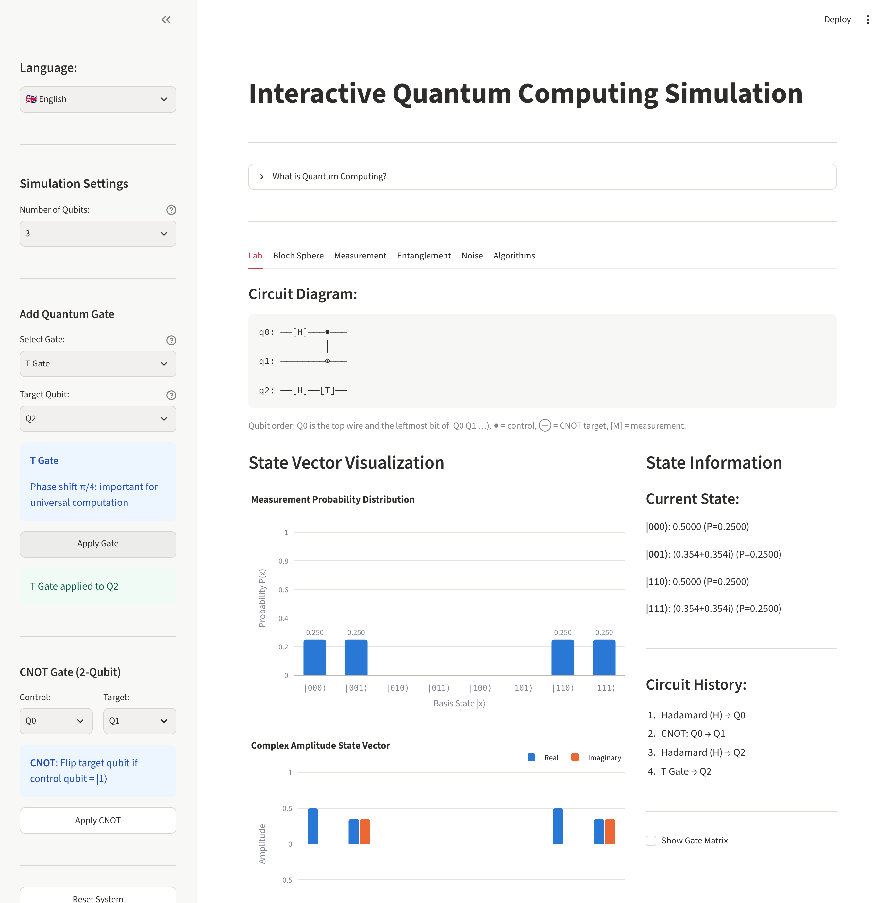
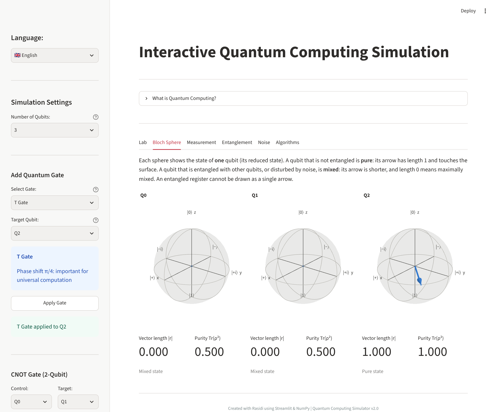
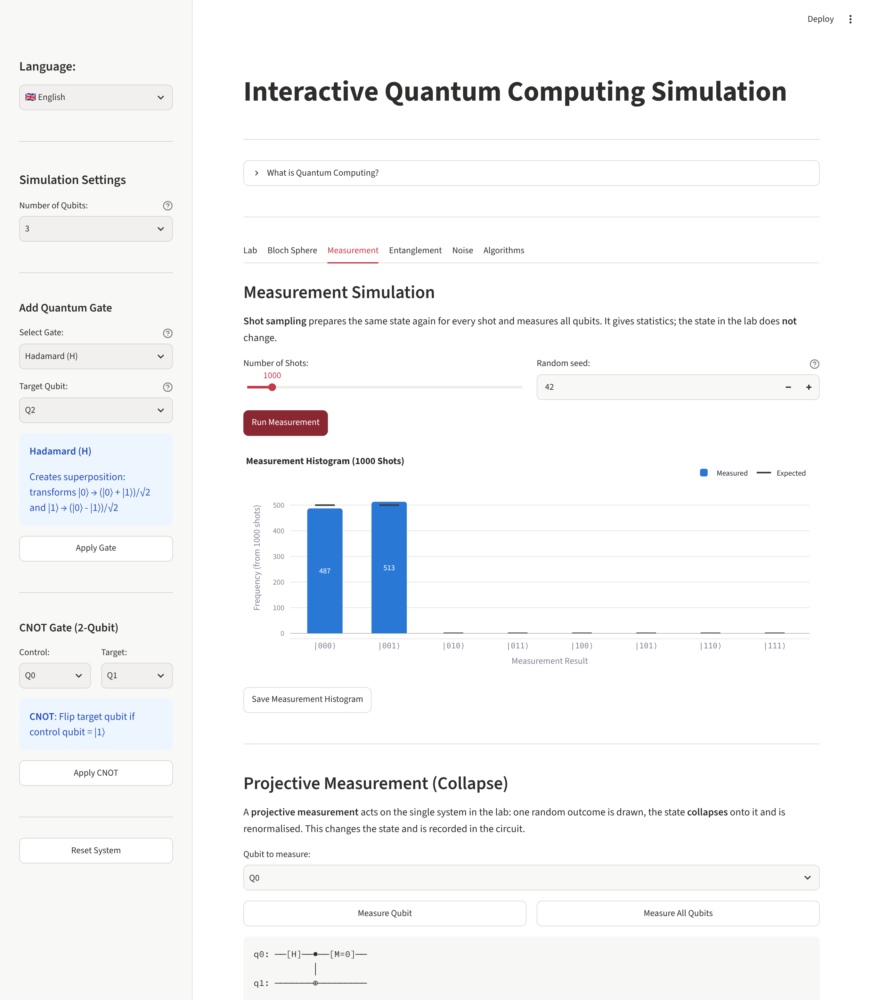
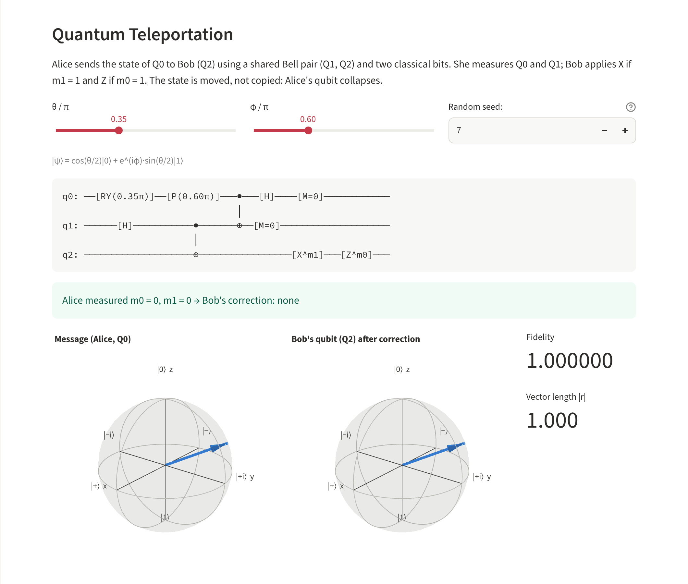
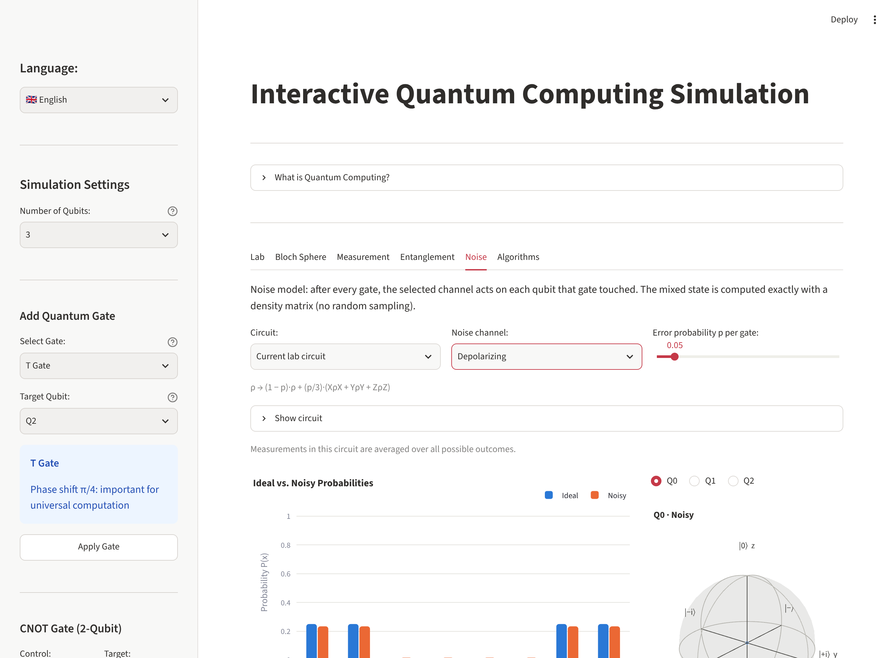
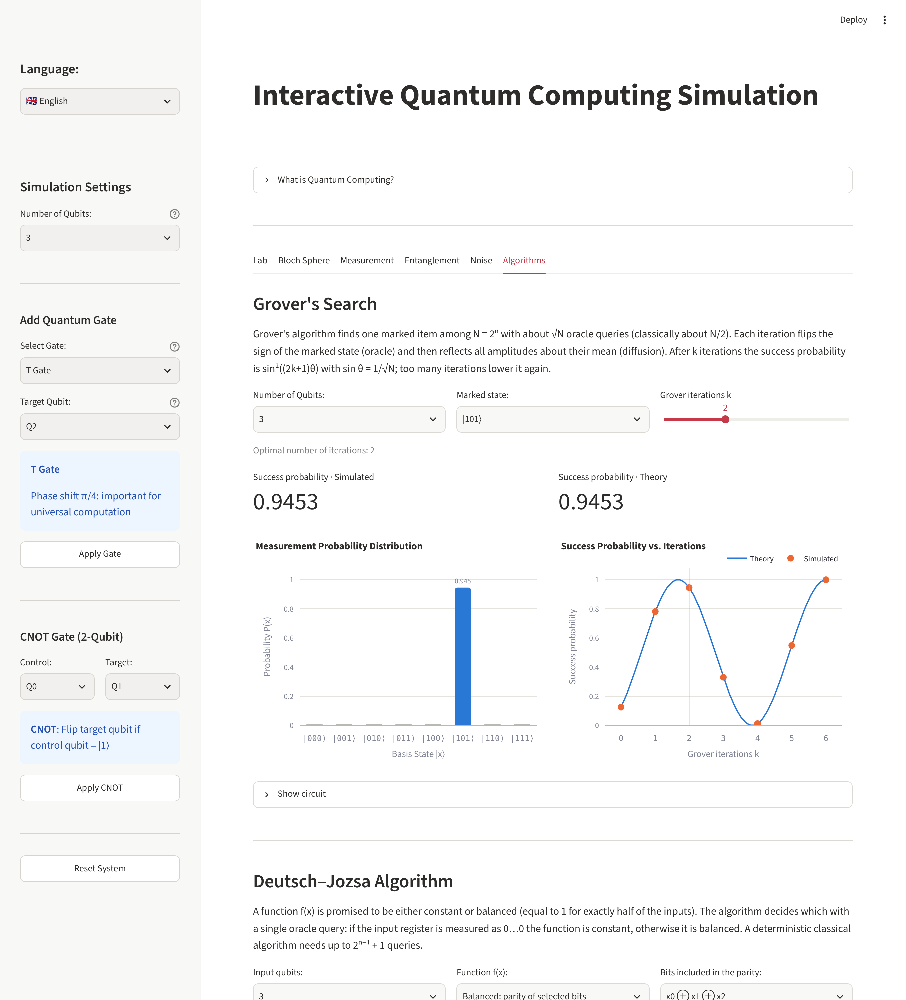

<h1 align="center">Mini Quantum Lab 2.0</h1>

<p align="center">
  <b>An interactive, tested quantum-computing simulator for learning</b><br>
  Python · NumPy · Streamlit · Plotly · 15 interface languages
</p>

---

## Overview

Mini Quantum Lab is an educational web application for exploring the basics of
quantum computing: build small circuits gate by gate, watch the state vector,
look at each qubit on a Bloch sphere, measure, add noise, and run a few textbook
protocols and algorithms.

Version 2.0 keeps the look and workflow of the original project and replaces
what is underneath: a separate, unit-tested simulation package with one
documented qubit-ordering convention, physically consistent measurement, and
new visualisations. The audit that motivated the changes is in
[`docs/AUDIT.md`](docs/AUDIT.md).

> This project is inspired by the visual style of tools such as IBM Quantum
> Composer and Qiskit. It is an independent educational project and is **not
> affiliated with or endorsed by IBM** or any other quantum-computing
> organisation. It simulates ideal and noisy qubits on a classical computer; it
> does not connect to quantum hardware.

## Features

| Area | What you can do |
|---|---|
| **Lab** | 1–6 qubits; gates I, X, Y, Z, H, S, T on any qubit; CNOT between any two qubits; live circuit diagram, state table and gate history |
| **State visualisation** | Probability distribution, real/imaginary amplitudes and the phase of every amplitude, with basis-state labels |
| **Bloch sphere** | Interactive 3D sphere per qubit, drawn from the qubit's *reduced* state, with vector length and purity so pure and mixed states are told apart |
| **Measurement** | Shot sampling (100–10 000 shots) with a seed, and projective measurement of one or all qubits with state collapse |
| **Entanglement** | Generator for the four Bell states with entropy and collapse demonstration; three-qubit quantum teleportation of any single-qubit state |
| **Noise** | Bit-flip, phase-flip and depolarizing channels applied after every gate, simulated exactly with a density matrix |
| **Algorithms** | Grover search (2–5 qubits) and Deutsch–Jozsa (1–4 input qubits) with explanations and circuits |
| **Languages** | English, Indonesian, Spanish, Mandarin Chinese, Arabic, French, Japanese, Korean, German, Portuguese, Russian, Hindi, Turkish, Italian, Vietnamese |

## Screenshots

| Lab: circuit, probabilities, amplitudes | Bloch spheres (Q0 and Q1 entangled, Q2 pure) |
|---|---|
|  |  |

| Shot sampling and projective measurement | Quantum teleportation |
|---|---|
|  |  |

| Noise: ideal vs. depolarized Bell state | Grover and Deutsch–Jozsa |
|---|---|
|  |  |

## Installation

Requires Python 3.11 or newer (tested on 3.11 and 3.13).

```bash
git clone https://github.com/rasidi3112/quantum-computing-simulation.git
cd quantum-computing-simulation
python -m venv .venv
source .venv/bin/activate          # Windows: .venv\Scripts\activate
pip install -r requirements.txt
streamlit run main.py
```

Then open <http://localhost:8501>.

Runtime dependencies are `numpy`, `streamlit` and `plotly`. The simulation
package itself (`quantum_lab`, without `visualization`) needs only NumPy.

## Usage

1. Choose the **number of qubits** in the sidebar (changing it starts a new,
   empty circuit).
2. Pick a gate and a target qubit and press **Apply Gate**; for two or more
   qubits, pick control and target and press **Apply CNOT**.
3. Read the result in the tabs:
   - **Lab**: circuit diagram, probabilities, amplitudes, phases, state table;
   - **Bloch Sphere**: one sphere per qubit;
   - **Measurement**: *Run Measurement* samples shots without touching the
     state; *Measure Qubit* / *Measure All Qubits* collapse it;
   - **Entanglement**, **Noise**, **Algorithms**: self-contained
     demonstrations. *Load into Lab* copies a Bell circuit into the lab.
4. **Reset System** returns to |0…0⟩ and restarts the random generator from the
   seed.

Charts are interactive (hover, zoom, rotate). The camera button in a chart's
toolbar saves a PNG; the *Save …* buttons download a standalone interactive
HTML file.

### Example circuits

| Goal | Steps | Expected result |
|---|---|---|
| Superposition | 1 qubit: H on Q0 | P(0) = P(1) = 0.5; Bloch vector on +x |
| Bell state \|Φ+⟩ | 2 qubits: H on Q0, CNOT Q0 → Q1 | (\|00⟩ + \|11⟩)/√2; P(00) = P(11) = 0.5, P(01) = P(10) = 0; both Bloch vectors have length 0 |
| H·Z·H = X | 1 qubit: H, Z, H on Q0 | \|1⟩ |
| GHZ state | 3 qubits: H on Q0, CNOT Q0 → Q1, CNOT Q1 → Q2 | (\|000⟩ + \|111⟩)/√2 |
| Collapse | Bell state, then *Measure Qubit* Q0 | \|00⟩ or \|11⟩; Q1 is now determined |

```
q0: ──[H]──●──
           │
q1: ───────⊕──
```

### Using the simulator from Python

```python
import numpy as np
from quantum_lab import Circuit, QuantumSimulator, gates

sim = QuantumSimulator(2)
sim.apply(gates.HADAMARD, [0])
sim.cnot(0, 1)
print(np.round(sim.state, 4))             # [0.7071 0 0 0.7071]
print(sim.sample_counts(1000, rng=42))    # [487 0 0 513] = counts of 00, 01, 10, 11
print(sim.measure_qubit(0, rng=7), sim.state)   # 0 [1 0 0 0]: collapsed to |00>

circuit = Circuit(2).gate("H", 0).cnot(0, 1).measure(0).measure(1)
print(circuit.draw())
print(circuit.run(rng=1).outcomes)        # {0: 0, 1: 0}; the two bits always agree
```

## Quantum mathematical conventions

**State.** A register of *n* qubits is a complex vector of 2ⁿ amplitudes αᵢ
with Σ|αᵢ|² = 1, initialised to |0…0⟩.

**Qubit ordering: big-endian, used everywhere.** Qubit 0 is the *leftmost*
bit of a basis label and the *top* wire of a diagram:

```
|q0 q1 … q(n-1)⟩      index = Σ_k q_k · 2^(n-1-k)      |ψ⟩ = |q0⟩ ⊗ |q1⟩ ⊗ … ⊗ |q(n-1)⟩
```

So with two qubits, X on Q0 turns |00⟩ into |10⟩ (index 2). A matrix acting on
the qubit list `[a, b]` treats `a` as its most significant bit; in particular
`gates.CNOT` is the matrix for `[control, target]`. This is the textbook
(Nielsen & Chuang) convention. **Qiskit uses the opposite, little-endian
order**; reverse the bit strings when comparing.

**Evolution.** Every operator is checked for unitarity (U†U = I, tolerance
10⁻¹⁰) before it is applied, and the state is never renormalised during
unitary evolution. Tests confirm the norm stays within 10⁻¹⁰ of 1 after 3000
gates.

**Measurement** (computational basis):

- *Shot sampling* draws outcomes from P(i) = |αᵢ|². It models preparing the
  same state again for every shot; the state is unchanged.
- *Projective measurement* of qubit *k* draws m ∈ {0, 1} with
  P(m) = Σ_{i: bit k = m} |αᵢ|², then replaces the state by
  P_m|ψ⟩ / √P(m). Measuring all qubits leaves a basis state.
- *Randomness.* An integer seed gives reproducible results
  (`numpy.random.default_rng`). In the app, shot sampling uses the seed
  directly (same seed and state → same histogram), while projective
  measurements consume one generator that is restarted on reset, on a change
  of seed and on a change of register size.

**Bloch vector.** For qubit *k* the reduced density matrix
ρ_k = Tr_{others} |ψ⟩⟨ψ| gives r = (Tr ρ_kX, Tr ρ_kY, Tr ρ_kZ) with
ρ_k = (I + r·σ)/2. |r| = 1 for a pure qubit, |r| < 1 when it is entangled
with other qubits or affected by noise, and purity Tr ρ_k² = (1 + |r|²)/2.
An entangled register has no single Bloch vector, so none is drawn.

**Noise.** After every gate the selected channel acts on each qubit that gate
touched (error probability *p* per application):

| Channel | Map |
|---|---|
| Bit flip | ρ → (1 − p)ρ + p XρX |
| Phase flip | ρ → (1 − p)ρ + p ZρZ |
| Depolarizing | ρ → (1 − p)ρ + (p/3)(XρX + YρY + ZρZ) |

With this parametrisation the depolarizing channel scales the Bloch vector by
1 − 4p/3 (p = 3/4 is the maximally mixed state). Idle qubits and measurements
are noiseless. The density matrix is evolved exactly; measurements inside a
noisy circuit are averaged over their outcomes.

**Fidelity.** ⟨ψ|ρ|ψ⟩ against a pure reference, and the Uhlmann fidelity
(Tr √(√ρ σ √ρ))² in general.

## Supported quantum gates

| Gate | Matrix | Action |
|---|---|---|
| Identity (I) | [[1, 0], [0, 1]] | leaves the qubit unchanged |
| Pauli-X | [[0, 1], [1, 0]] | bit flip \|0⟩ ↔ \|1⟩ |
| Pauli-Y | [[0, −i], [i, 0]] | Y\|0⟩ = i\|1⟩, Y\|1⟩ = −i\|0⟩ |
| Pauli-Z | [[1, 0], [0, −1]] | phase flip \|1⟩ → −\|1⟩ |
| Hadamard (H) | [[1, 1], [1, −1]]/√2 | \|0⟩ → \|+⟩, \|1⟩ → \|−⟩ |
| S | diag(1, i) | phase π/2 |
| T | diag(1, e^{iπ/4}) | phase π/4 |
| CNOT | \|0⟩⟨0\| ⊗ I + \|1⟩⟨1\| ⊗ X | flips the target if the control is \|1⟩ |

The Python API additionally offers `rx`, `ry`, `rz`, `phase`, arbitrary
unitaries on any qubit list, and multi-controlled single-qubit gates; they are
used by the teleportation and Grover circuits but are not yet in the sidebar.

## Algorithms and protocols

- **Bell states.** X gates select the input, then H and CNOT.
- **Teleportation.** Q0 carries cos(θ/2)|0⟩ + e^{iφ}sin(θ/2)|1⟩, Q1–Q2 share a
  Bell pair. Alice applies CNOT and H and measures Q0, Q1; Bob applies X if
  m₁ = 1 and Z if m₀ = 1. The displayed fidelity is computed from the simulated
  state and is 1 in all four branches.
- **Grover.** Oracle = X on the zero bits of the marked item, multi-controlled
  Z, X again; diffusion = Hⁿ Xⁿ (MCZ) Xⁿ Hⁿ. The simulated success probability
  matches sin²((2k+1)θ), sin θ = 1/√N.
- **Deutsch–Jozsa.** The oracle U_f|x⟩|y⟩ = |x⟩|y ⊕ f(x)⟩ is built from the
  truth table of f. The app offers constant functions, parities of selected
  bits and random balanced functions.

## Architecture

```
quantum-computing-simulation/
├── main.py                  Streamlit interface (widgets, session state, layout)
├── translations.py          original 54 keys × 15 languages + lookup helpers
├── translations_extra.py    80 keys added in 2.0 × 15 languages
├── quantum_lab/             simulation core, no Streamlit imports
│   ├── gates.py             gate matrices, unitarity check, dense reference expansions
│   ├── simulator.py         QuantumSimulator (state vector)
│   ├── measurement.py       probabilities, shot sampling, projective collapse
│   ├── states.py            reduced density matrices, Bloch vectors, entropy
│   ├── circuit.py           Circuit / Operation, execution, text diagram
│   ├── density.py           DensityMatrix (mixed states)
│   ├── noise.py             Kraus channels, noisy circuit simulation
│   ├── protocols.py         Bell, GHZ, teleportation
│   ├── algorithms.py        Grover, Deutsch–Jozsa
│   └── visualization.py     Plotly figures
├── tests/                   pytest suite (500 tests)
├── benchmarks/bench_gates.py
├── docs/AUDIT.md            audit of version 1.0
├── assets/                  screenshots
├── requirements.txt         runtime dependencies
└── requirements-dev.txt     + pytest, ruff
```

Dependencies point one way: `main.py` → `quantum_lab` and `translations`;
inside the package, `visualization` is the only module that imports Plotly and
nothing imports Streamlit, so the core can be used and tested on its own.

## Testing

```bash
pip install -r requirements-dev.txt
pytest                 # about 1.5 minutes; most of it is the browserless UI tests
pytest --ignore=tests/test_app.py     # core only, a few seconds
ruff check .
python benchmarks/bench_gates.py
```

| File | Covers |
|---|---|
| `test_gates.py` | unitarity of every gate, algebraic identities, Kronecker expansion, CNOT matrices |
| `test_simulator.py` | normalisation, Pauli/Hadamard behaviour, H twice, CNOT truth tables, Bell and GHZ states, comparison with dense matrices, invalid input |
| `test_measurement.py` | Born rule, marginals, seeded sampling, statistics, collapse and renormalisation |
| `test_states.py` | partial trace, Bloch vectors, purity, entanglement entropy |
| `test_circuit.py` | circuit construction and execution, conditioned gates, diagram layout |
| `test_noise.py` | channels are trace preserving, analytic results, exhaustive sum over error trajectories |
| `test_protocols.py` | four Bell states, teleportation in all four branches |
| `test_algorithms.py` | Grover against the closed form, Deutsch–Jozsa for every balanced function on 2 and 3 inputs |
| `test_visualization.py` | figures contain the right data |
| `test_translations.py` | 15 languages, identical keys and placeholders, every key used by the UI exists |
| `test_app.py` | the Streamlit app end to end (headless), in every language |

Numerical comparisons use tolerances (10⁻¹² for amplitudes, 5σ bands for
sampling statistics) rather than exact floating-point equality.

Verified combinations: Python 3.11 with NumPy 1.26.4 / Streamlit 1.50.0 /
Plotly 5.24.0 (the lower bounds in `requirements.txt`), and Python 3.13 with
NumPy 2.5.4 / Streamlit 1.67.0 / Plotly 7.1.0.

## Performance and limits

| Quantity | State vector | Density matrix |
|---|---|---|
| Memory | 16 · 2ⁿ bytes | 16 · 4ⁿ bytes |
| One k-qubit gate | O(2ⁿ · 2ᵏ) | O(4ⁿ · 2ᵏ) |
| Hard limit in the code | `MAX_QUBITS = 20` (16 MiB) | `MAX_DENSITY_QUBITS = 10` (16 MiB) |
| Limit in the interface | 6 qubits | 6 qubits |

Version 1.0 built a dense 2ⁿ × 2ⁿ matrix for every gate; 2.0 contracts the
gate with the state tensor. Measured with `benchmarks/bench_gates.py` (one
Hadamard, best of several runs, single machine; treat as indicative):

| Qubits | Dense matrix (1.0) | Contraction (2.0) | Ratio |
|---|---|---|---|
| 3 | 35 µs | 40 µs | 0.9× |
| 6 | 100 µs | 43 µs | 2× |
| 8 | 553 µs | 44 µs | 13× |
| 10 | 7.6 ms | 49 µs | 155× |
| 12 | 184 ms | 57 µs | ≈ 3200× |

At the old three-qubit limit there is no speed-up (input validation costs a
few microseconds); the benefit is that larger registers became practical.
Simulation cost still doubles with every qubit. This is a teaching tool for
small registers, not a general-purpose simulator.

## Known limitations

- The interface offers 1–6 qubits; the gate set in the sidebar is
  I, X, Y, Z, H, S, T and CNOT. Rotation gates exist only in the Python API.
- Measurement is in the computational (Z) basis only.
- Noise is single-qubit Pauli noise after gates. There is no amplitude
  damping, no readout error, no idle noise and no correlated noise.
- Grover searches for a single marked item; the Deutsch–Jozsa oracle is applied
  as one unitary box rather than decomposed into elementary gates.
- The circuit is append-only (no undo, no editing, no drag and drop).
- The circuit diagram is monospaced text; very long circuits scroll
  horizontally.
- Arabic is translated but the page layout is not mirrored right-to-left.
- The 80 strings added in 2.0 were translated without review by native
  speakers; corrections are welcome.
- No connection to real quantum hardware or cloud back ends.

## Changes from 1.0 that may affect you

- **CNOT results differ because the old ones were wrong.** 1.0 mixed two qubit
  orderings, so circuits combining single-qubit gates with CNOT gave incorrect
  states (see `docs/AUDIT.md`, finding Q1).
- `QuantumSimulator` moved from `main.py` to `quantum_lab`. Its 1.0 methods
  (`apply_gate`, `get_probabilities`, `get_amplitudes`, `measure`, `reset`,
  `_expand_gate`, `_create_cnot_matrix`) are kept. Invalid input now raises
  `ValueError`/`TypeError` instead of being silently accepted, `state` is
  read-only, and non-unitary matrices are rejected.
- The measurement histogram appears after pressing *Run Measurement* instead
  of being regenerated on every interaction.
- Plots are Plotly instead of Matplotlib. The *Save …* buttons now download
  interactive HTML; PNG export is in each chart's toolbar.
- `matplotlib` and the unused `qiskit` were removed from `requirements.txt`;
  `plotly` was added.

## Deployment on Streamlit Community Cloud

1. Push the repository (or your fork) to GitHub.
2. Sign in at <https://share.streamlit.io> with GitHub and create a new app.
3. Select the repository and branch, and set the main file path to `main.py`.
4. In the advanced settings choose Python 3.11 or newer, then deploy.

Dependencies are installed from `requirements.txt`; no secrets or environment
variables are needed. These steps were written from experience with the
platform and could not be checked against its current documentation while
preparing this release. If the screens differ, follow
<https://docs.streamlit.io/deploy/streamlit-community-cloud>.

The `.devcontainer` configuration starts Streamlit with CORS and XSRF
protection disabled, which GitHub Codespaces' port forwarding requires. Do not
reuse those flags for a public deployment.

## Roadmap

- Rotation gates (Rx, Ry, Rz) and more two-qubit gates (CZ, SWAP) in the sidebar
- Undo and circuit editing; save and load circuits
- Measurement in other bases; expectation values of Pauli observables
- Amplitude-damping and readout-error channels
- Export of circuits to OpenQASM
- Review of the translations by native speakers; right-to-left layout

## License and attribution

Released under the [MIT License](LICENSE), Copyright (c) 2025 rasidi3112. The license
file is unchanged.

Mini Quantum Lab was created by [Rasidi](https://github.com/rasidi3112), who
wrote the original application, interface and translations. Version 2.0
(simulation core, tests, visualisations and the added features) builds on that
work.
